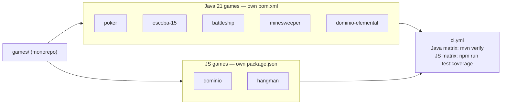

# 🎮 Games


A monorepo of small, self-contained games from the [Lantieridev](https://github.com/Lantieridev) portfolio — 5 in Java (terminal, POO-heavy) and 2 in vanilla JS (browser). Each one is independent: its own `pom.xml`/`package.json`, its own test suite, its own README with full rules and architecture notes.

For the flagship, larger project (Human vs. AI, full frontend/backend), see [pokemon-tcg-tpi](https://github.com/Lantieridev/pokemon-tcg-tpi) — it stays in its own repo.

## Index

| Game | Stack | Tests | Coverage | Run |
|---|---|---|---|---|
| [poker](poker/) | Java 21, terminal | 85 | 46% line / 33% branch | `mvn compile exec:java` |
| [escoba-15](escoba-15/) | Java 21, terminal | 60 | 83% line / 77% branch | `mvn compile exec:java` |
| [battleship](battleship/) | Java 21, terminal | 32 | 38% line / 33% branch | `mvn compile exec:java` |
| [minesweeper](minesweeper/) | Java 21, terminal | — | **100% line / 99% branch** | `mvn compile exec:java` |
| [dominio-elemental](dominio-elemental/) | Java 21, terminal | 78 | 96% line / 87% branch | `mvn compile exec:java` |
| [dominio](dominio/) | JS, Vite, Tailwind, browser | 141 | **100% line / 99% branch** | `npm install && npm run dev` |
| [hangman](hangman/) | JS, Vitest, browser | 28 | **100% line / branch** | `npm install && npm test`, then open `index.html` |

Folder names match the actual game, plainly — no `-pro`/`-premium`/`-engine` marketing suffixes. `dominio` (an 8×8 cyclic-dominance strategy game) and `dominio-elemental` (a 36-card combination game) are unrelated games that happen to share a root name in Spanish — both are named after their real academic assignment titles.

## Structure



Cada juego es independiente — sin dependencias cruzadas entre carpetas, solo comparten el CI root que corre el gate real de cada uno.

## Testing

Every game has its own test suite, its own coverage bar, and a JaCoCo/Vitest gate that fails the build on a regression — run them from inside each subfolder:

```bash
cd <game>
mvn verify              # Java games — tests + coverage gate
npm run test:coverage   # JS games — Vitest + coverage thresholds
```

`poker`, `escoba-15`, and `battleship` have documented, real coverage gaps below the other four (mostly `Scanner`-driven interactive loops and combinatorial logic like poker's hand evaluator) — each gate is set to that honest current floor rather than a number the build can't actually meet, and noted here rather than papered over with fake tests.

CI (`.github/workflows/ci.yml`) runs every game's real gate on every push — a Java game matrix (`mvn verify`) and a JS game matrix (`npm run test:coverage`).

## History

Each of these started as an individual academic assignment (UTN FRC, Backend/Frontend Programming) and was later cleaned up, bug-fixed, and brought up to a real testing bar for the portfolio. They were consolidated here from separate repos on 2026-07-09 to keep the profile focused — the original repos are archived, not deleted.

---

*Developed by [Martin Lantieri](https://github.com/Lantieridev) - 2026*
